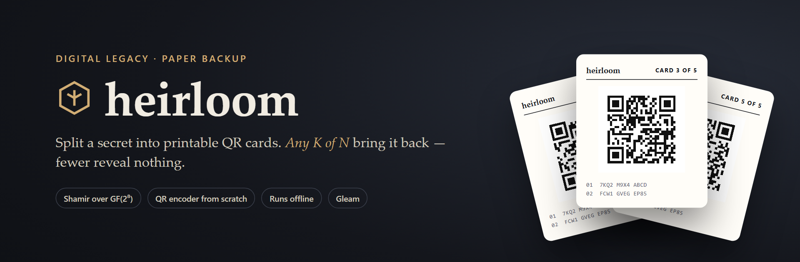
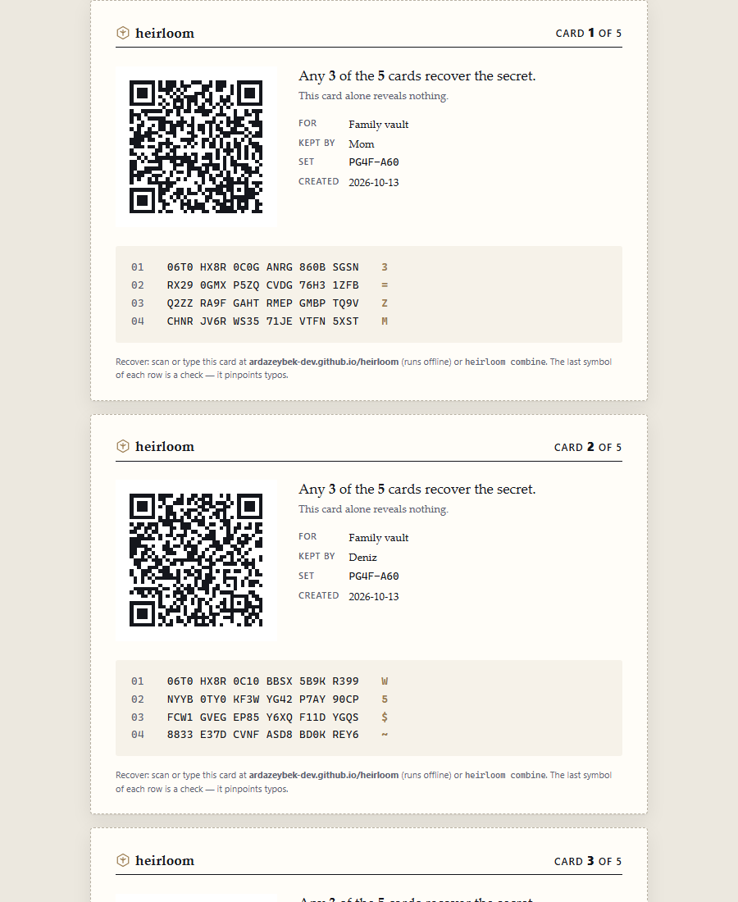
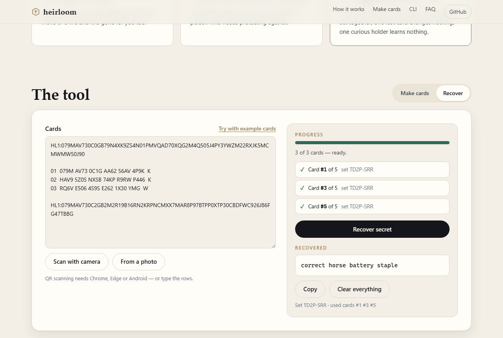
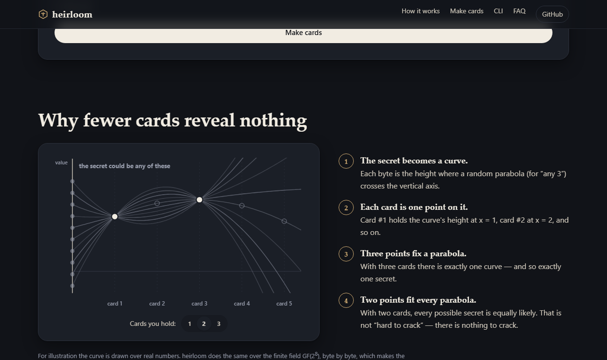

<p align="center">
  
</p>

<p align="center">
  <a href="https://github.com/ardazeybek-dev/heirloom/actions/workflows/ci.yml"></a>
  <a href="https://ardazeybek-dev.github.io/heirloom/"></a>
  <a href="https://gleam.run"></a>
  <a href="LICENSE"></a>
</p>

<p align="center">
  <b><a href="https://ardazeybek-dev.github.io/heirloom/">Live playground</a></b> ·
  <a href="#command-line">Command line</a> ·
  <a href="docs/FORMAT.md">Card format</a> ·
  <a href="#security-model">Security model</a>
</p>

---

**Your password manager has one master password. Where does it go?** On a sticky note, one burglar gets everything. In one relative's head, one accident loses it. In nobody's head, your family is locked out of everything you leave behind.

**heirloom** splits a secret — a master password, 2FA recovery codes, a wallet seed — into printable QR cards using [Shamir's Secret Sharing](https://en.wikipedia.org/wiki/Shamir%27s_secret_sharing). Give one card each to people you trust. **Any K of the N cards recover the secret. K − 1 cards reveal nothing at all** — not a hint, not even its length. Lose a card or two and nothing happens; a holder who gets curious learns nothing.

It runs entirely in your browser (the page's Content-Security-Policy forbids network access) or as a single-file command-line tool, and both use the same typed core written in [Gleam](https://gleam.run).

<p align="center">
  
</p>

## Features

- **K-of-N secret sharing over GF(2⁸)** — any threshold from 2 to 255 cards; information-theoretically secure below the threshold.
- **Printable cards** — a self-contained HTML sheet: a distribution page (no secret material) plus one card per holder with QR code, label, holder name, set fingerprint and recovery instructions. A4 or US Letter.
- **QR encoder written from scratch** — alphanumeric/byte segments, Reed–Solomon ECC, block interleaving, all eight masks with penalty scoring, versions 1–40. Cross-checked against OpenCV's decoders in CI.
- **Typo-proof manual entry** — if a QR code is damaged, the card text can be typed. It uses Crockford Base32 (no `I L O U`, case-insensitive) in numbered rows, each with a mod-37 check symbol, so a typo is reported as *"row 3"*.
- **Forgery and damage detection** — every card has a CRC-32; with more cards than needed, heirloom cross-checks them (shares form a Reed–Solomon codeword) and names the card that disagrees.
- **Length hiding** — the secret's type and length are shared with it and padded to 16-byte blocks.
- **Recover by camera** — the playground scans card QR codes with your camera or from a photo (BarcodeDetector), or accepts pasted/typed text.
- **Offline by design** — no runtime dependencies, no network access, no storage. [`heirloom-offline.html`](https://ardazeybek-dev.github.io/heirloom/heirloom-offline.html) is the whole tool in one file that opens from disk; or use the CLI on an air-gapped machine.

## Screenshots

| Make cards and recover | How it works |
| --- | --- |
|  |  |

## Quick start

**In the browser:** open the [playground](https://ardazeybek-dev.github.io/heirloom/), type the secret, choose *any K of N*, print. To recover, paste or scan K cards.

**From source** (Node.js ≥ 20.12, [Gleam](https://gleam.run/getting-started/installing/) ≥ 1.19):

```sh
git clone https://github.com/ardazeybek-dev/heirloom.git
cd heirloom
npm install          # esbuild, used to bundle the compiled Gleam
npm run build        # gleam build + bundle → dist/heirloom.mjs, web/heirloom.js, web/heirloom-offline.html
npm link             # optional: puts `heirloom` on your PATH
```

## Command line

```sh
# 5 cards, any 3 recover, holders printed on the cards
heirloom split -k 3 -n 5 --label "Family vault" --holders "Mom,Deniz,Lawyer,Safe box,Me" < secret.txt
# ✓ 5 cards written to cards.html · any 3 recover · set PG4F-A60 · QR version 5-M

# The same as plain text (to engrave, or to store in separate places)
heirloom split -k 2 -n 3 --text < secret.txt

# Binary secrets such as keys or wallet seeds
echo "3f9a0c11…" | heirloom split --hex -k 2 -n 3 -o seed-cards.html

# Recover: one card per file, or several in one file separated by blank lines
heirloom combine card1.txt card3.txt card4.txt

# Check cards without revealing anything (readable? same set? consistent?)
heirloom verify card2.txt card5.txt

# Bonus: draw any text as a QR code in the terminal, or as SVG
heirloom qr "WIFI:S:home;T:WPA;P:correct-horse;;"
heirloom qr "https://example.com" --svg -o code.svg
```

| Command | What it does |
| --- | --- |
| `split` | Reads the secret from stdin (or `--secret-file`), writes a printable HTML sheet (`-o`, default `cards.html`) or text (`--text`). Re-combines the cards before writing anything as a self-test. |
| `combine` | Reads cards from files or stdin, prints the secret to stdout (`--hex` for bytes). Diagnostics go to stderr, so the output can be piped. |
| `verify` | Checks each card's checksum and rows, groups them by set and, when enough are present, confirms they are mutually consistent — without printing the secret. |
| `qr` | Encodes any text with the built-in QR encoder. |

Run `heirloom --help` for every option.

## Configuration

Settings can be passed as flags, environment variables, or a `.env` file in the working directory (copy [.env.example](.env.example)). Flags win over the environment.

| Variable | Default | Meaning |
| --- | --- | --- |
| `HEIRLOOM_THRESHOLD` | `3` | Cards needed to recover (`-k`) |
| `HEIRLOOM_SHARES` | `5` | Cards to make (`-n`) |
| `HEIRLOOM_QR_LEVEL` | `M` | QR error correction: `L`, `M`, `Q` or `H` (`--ecl`) |
| `HEIRLOOM_PAPER` | `a4` | `a4` or `letter` (`--paper`) |
| `HEIRLOOM_RECOVERY_URL` | `ardazeybek-dev.github.io/heirloom` | Recovery address printed on cards — point it at your own copy |
| `NO_COLOR` | — | Disable coloured output |

The secret itself is never read from the environment — keep it out of `.env` files and shell history.

## How it works

1. The secret is wrapped as `kind · length · bytes · zero padding` ([format](docs/FORMAT.md#plaintext)).
2. For every byte *s*, a random polynomial *f(x) = s + a₁x + … + aₖ₋₁xᵏ⁻¹* is drawn over GF(2⁸) using the browser's or Node's CSPRNG. Card *i* stores *f(i)* for every byte.
3. Any K cards determine the polynomials by Lagrange interpolation, and *f(0)* is the secret. With K − 1 cards, every value of *f(0)* is equally consistent — the missing information simply is not there.
4. Each card is serialised with a header and CRC-32, encoded in Crockford Base32, and rendered both as a QR code (alphanumeric mode, 5.5 bits per character) and as numbered rows with check symbols.
5. When more than K cards are presented, each K-subset proposes a polynomial; the one agreeing with the most cards wins. With *b* bad cards among *m*, the honest polynomial wins whenever *b ≤ (m − K) / 2*, and the bad cards are named.

## Security model

| Protects against | Does not protect against |
| --- | --- |
| Theft or loss of up to K − 1 cards | A compromised computer at the moment you split or recover |
| A curious holder (one card reveals nothing) | K holders deciding to collude — that is what K means |
| Typos and smudges (row checks + CRC-32) | A copy left in your printer queue or downloads folder |
| Forged or altered cards, **if** extra cards are available | A forgery when exactly K cards are presented (nothing to compare against) |

Practical advice: split on a machine you trust — ideally offline, with the one-file offline copy or the CLI — print, verify one card with *Recover*, then delete the HTML file. Cards from different splits never combine, so re-splitting retires the old set. Report vulnerabilities as described in [SECURITY.md](SECURITY.md).

## Project structure

```
heirloom/
├── src/
│   ├── heirloom.gleam            CLI entry point
│   ├── heirloom/
│   │   ├── gf256.gleam           GF(2⁸) arithmetic (AES and QR polynomials)
│   │   ├── shamir.gleam          split, combine, Lagrange interpolation, audit
│   │   ├── secret.gleam          plaintext framing and padding
│   │   ├── share.gleam           card binary layout, compact text, rows, parsing
│   │   ├── base32.gleam          Crockford Base32 and row check symbols
│   │   ├── crc32.gleam           CRC-32 (IEEE)
│   │   ├── kit.gleam             high-level split / recover
│   │   ├── card.gleam            printable HTML cards and stylesheet
│   │   ├── qr.gleam              QR encoder pipeline
│   │   ├── qr/                   tables, segments, Reed–Solomon, matrix, SVG
│   │   ├── cli.gleam, cli/       commands and argument parsing
│   │   └── web.gleam             API for the browser playground
│   ├── heirloom_ffi.mjs          Web Crypto randomness, date
│   └── heirloom_node_ffi.mjs     Node.js file, stdin and env access
├── test/                         gleeunit tests (core, QR known-answer vectors)
├── scripts/
│   ├── bundle.mjs                esbuild: CLI bundle, browser bundle, one-file offline page
│   ├── qr-dump.mjs               emits QR matrices for cross-checking
│   └── verify_qr.py              decodes them with OpenCV
├── web/                          static playground (GitHub Pages)
├── docs/FORMAT.md                card format specification
├── Dockerfile                    container image of the CLI
└── .env.example                  configuration template
```

## Development

```sh
gleam test                  # unit tests: field axioms, CRC check value, Shamir subsets,
                            # forgery detection, QR known-answer vectors, all 40 grid layouts
npm run build               # compile and bundle
npm run verify:qr           # decode 72 generated symbols (v1–v32, all levels) with OpenCV
npm run dev:web             # serve the playground locally
```

The OpenCV check needs Python with `opencv-python-headless`. See [CONTRIBUTING.md](CONTRIBUTING.md).

### Docker

```sh
docker build -t heirloom .
docker run --rm -i --network none heirloom split -k 2 -n 3 --text < secret.txt
```

`--network none` makes the container's isolation match the tool's promise.

## Pitfalls

- **OpenCV fails to decode large QR symbols** → its classic `QRCodeDetector` cannot *locate* v19+ symbols → try `QRCodeDetectorAruco` as well (as `verify_qr.py` does).
- **The playground is blank when opened from disk** → browsers block ES modules on `file://` → open `heirloom-offline.html` (inline classic script, allowed by a CSP hash) or serve `web/` over HTTP.
- **Typing a secret on Windows never ends** → stdin needs end-of-file → press `Ctrl+Z` then `Enter` (`Ctrl+D` elsewhere), or use `--secret-file`.

## License

[MIT](LICENSE) © 2026 Arda Zeybek
